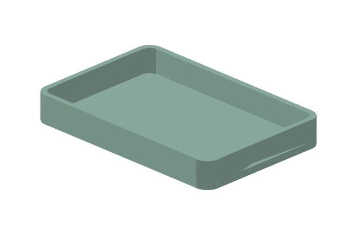

# Isolated CadQuery tray experiment (T-05)

This is an approved **experiment**, not a catalog migration. It uses CadQuery
2.8.0 in a separate Python 3.12 environment. The original catalog, core dependency
list, CLI and local preview do not need or import CadQuery.
`constraints.txt` records the tested transitive versions; platform-specific
dependencies are constrained only when selected by the installer.

## Run on Windows

From the repository root:

```powershell
python -m venv experiments\cadquery\.venv
experiments\cadquery\.venv\Scripts\python.exe -m pip install -r experiments\cadquery\requirements.txt
experiments\cadquery\.venv\Scripts\python.exe experiments\cadquery\probe.py
```

Default outputs are under `experiments\cadquery\artifacts\windows`: an unrounded
reference tray, a rounded 96 x 64 x 16 mm tray, and a rounded 120 x 80 x 18 mm tray.
Each includes STEP, STL, a geometry SVG, and an evidence report. Both rounded
cases use a 6 mm outer corner radius, 2.4 mm walls and a 2 mm base.

**Windows and Linux software checks passed.** See the
[choose/decline report](report.md) and [cross-platform evidence](artifacts/comparison.json).
No model has been sliced or physically printed.

| Trial | Windows exports | Linux exports |
|---|---|---|
| Sharp reference | [STL](artifacts/windows/reference-sharp.stl), [STEP](artifacts/windows/reference-sharp.step) | [STL](artifacts/linux/reference-sharp.stl), [STEP](artifacts/linux/reference-sharp.step) |
| Rounded 96 x 64 x 16 mm | [STL](artifacts/windows/rounded-96.stl), [STEP](artifacts/windows/rounded-96.step) | [STL](artifacts/linux/rounded-96.stl), [STEP](artifacts/linux/rounded-96.step) |
| Rounded 120 x 80 x 18 mm | [STL](artifacts/windows/rounded-120.stl), [STEP](artifacts/windows/rounded-120.step) | [STL](artifacts/linux/rounded-120.stl), [STEP](artifacts/linux/rounded-120.step) |



For Linux use `.venv/bin/python` in the same experiment directory. The dedicated
workflow runs Linux checks without adding CAD to the normal Pages pipeline.

## Customize within the experiment

```powershell
experiments\cadquery\.venv\Scripts\python.exe experiments\cadquery\probe.py --custom --length 110 --width 70 --height 16 --radius 5 --output build\cadquery-custom
```

Parameters are millimeters. Supported ranges: length 60-160, width 40-120,
height 10-30, wall 2-3 and base 1.6-3. Radius is either zero (sharp reference) or
between wall + 0.5 and one quarter of the smaller horizontal dimension.
The relationship limits preserve a bounded, simple rounded tray. Invalid
parameters fail before CAD operations. A new export always gets fresh checks;
no slicer or physical evidence is inherited.

The editable source is `design.py`. STEP preserves BRep geometry, **not** the
Python feature/parameter history. Preserve source, parameters and report with
both exports. The exporter uses absolute 0.02 mm linear deflection and 0.1 radian
angular tolerance, binary STL and serial meshing; no repair operations are used.

## Test

```powershell
experiments\cadquery\.venv\Scripts\python.exe -m unittest discover -s experiments\cadquery -p test_probe.py -v
python -m tools.release --check
python experiments\cadquery\compare.py
```

Checks include a valid single kernel solid, analytic volume agreement, mesh
edge/winding/connectivity checks, dimensions and volume against G-2, and STEP
round-trip validity. Existing mesh checks are only a supplement to kernel checks,
not an arbitrary AI-mesh safety validator.

## What's built, what isn't

The trial produces original STEP/STL files and software evidence. It does not
change the default catalog, introduce paid services, launch a slicer or control
a printer. No slicer or physical print verification is claimed. Adoption requires
a separate decision after reviewing `report.md`.

## License boundaries

`design.py`, its generated original models/previews/reports, and this guide are
**CC BY 4.0**, attributed to OpenPrintLab contributors under the root
`LICENSE-CONTENT.md`. `probe.py`, tests and workflow code are **MIT**.
CadQuery and its dependencies keep their own licenses; they are not relicensed
by this repository. Installed package declarations and license-file hashes are
recorded in `environment-and-results.json`. This is not a legal compliance audit.
